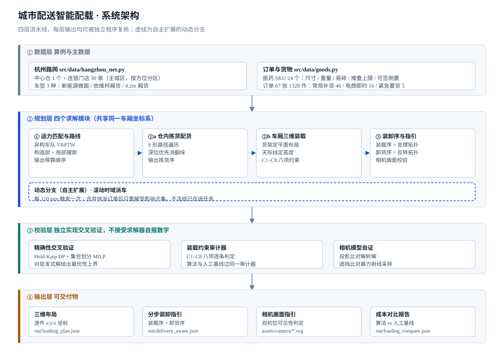
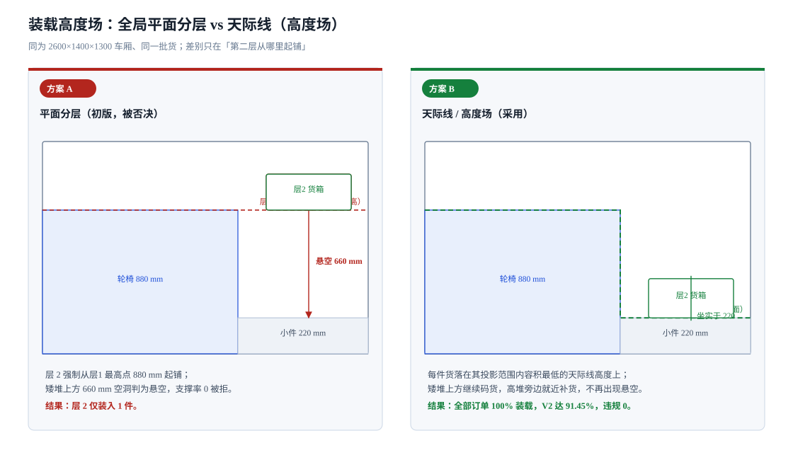
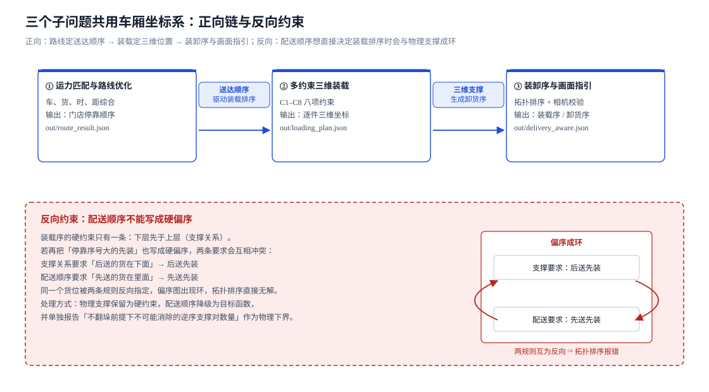
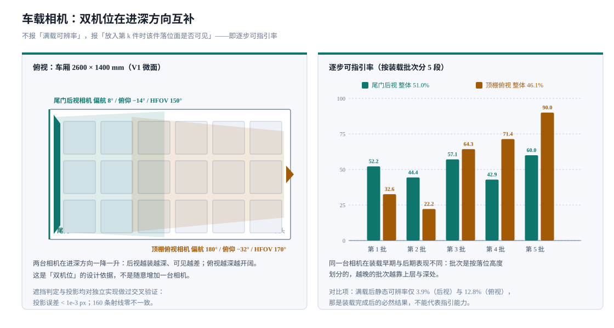

# 传化 AI 供应链架构师 · 城市配送智能配载

把城市配送的配载工作拆成四个可独立复核的环节：运力匹配与路线优化、仓内配货、
车厢三维装载、装卸序与画面指引。每个环节输出结构化结果，并由另一套独立实现的
程序交叉验证，而不是只给一张示意图。

场景为杭州医药城配：1 个中心仓、30 家连锁药店、24 个医药 SKU、67 张订单。
所有数据为公开信息基础上的合成算例，不含任何企业真实运营数据，详见第 8 节。

---

## 1 命题与作答范围

| 项 | 内容 |
|---|---|
| 赛事 | 传化 AI 供应链架构师黑客松 |
| 赛道 | 物流（另两个赛道为功能化学、生物技术） |
| 命题 | 城市配送智能配载 |
| 三个子问题 | 智能运力匹配与路线优化 / 多约束智能装载 / 智能装卸可视化 |
| 作答范围 | 三个子问题全部作答，另做两项自主扩展 |
| 本次重点 | 车载相机视角下的载货规划，以及逐步可指引能力校验 |

三个子问题共用同一份订单数据和同一个车厢坐标系，这是把它们放在一个仓库里的原因：
单独做路线优化，装载方案就与路线脱钩；单独做装载，装卸顺序又无法与配送先后挂钩。

| 子问题 | 命题要求 | 本仓库实现 | 定位 |
|---|---|---|---|
| 一 运力匹配与路线优化 | 综合车辆资源、配送距离、订单需求、交付时效，给出成本更优的车辆分配与路线 | 异构车队 VRPTW，构造层加局部搜索；另设精确层给出最优性上界 | 命题内 |
| 二 多约束智能装载 | 结合载重、车厢空间结构、堆叠规则，自动生成利用率较高的装载方案 | C1 至 C8 八项约束装载引擎，三种车型分别过同一个审计器 | 命题内 |
| 三 智能装卸可视化 | 生成 3D 货物摆放示意与分步装卸指引，减少重复搬运 | 三维布局、装载序与卸货序、车载相机画面指引与可见性校验 | 命题内 |
| 附 仓内拣货配货 | 未要求 | S 形路径加深位优先，消除翻垛 | 自主扩展 |
| 附 电商即时要货动态派车 | 未要求 | 滚动时域重优化，6 个波次 | 自主扩展 |

后两项在正文中一律标注为自主扩展，不计入命题要求的完成度。

---

## 2 系统架构



### 2.1 四层流水线

| 层 | 职责 | 模块 | 产出 |
|---|---|---|---|
| 数据层 | 生成算例与主数据 | `src/data/hangzhou_net.py`、`src/data/goods.py` | `out/network.json`、`out/orders.json` |
| 规划层 | 四个求解模块，共享同一车厢坐标系 | `src/route/vrptw.py`、`src/picking/pick_planner.py`、`src/loading/layer_packer.py`、`src/unload/unload_guide.py` | 路线、拣货序、三维布局、装卸序 |
| 校验层 | 独立实现交叉验证，不接受求解器自报数字 | `src/route/milp_verify.py`、`tests/*`、`src/vision/camera_check.py` | 最优性上界、约束违规清单、投影与遮挡结论 |
| 输出层 | 可交付物 | `src/vision/render_view.py`、`compare_loading.py` | 相机画面指引 SVG、成本对比报告 |

路径解析统一走 `src/paths.py`，做法是向上查找同时含 `out/` 与 `src/` 的目录。
早期各模块按 `Path(__file__).parents[N]` 各自推导项目根，而 `src/**` 与 `tests/*`
的层级不同，同一个函数在不同调用点解析出不同目录。改为按目录特征查找后与文件深度无关。

### 2.2 模块间的数据契约

规划层四个模块之间不直接调用，只通过 `out/` 下的 JSON 传递，因此任一模块可以单独重跑。

| 上游 | 交付字段 | 下游 |
|---|---|---|
| `hangzhou_net` + `goods` | 节点坐标、时间窗、距离矩阵、SKU 属性、订单行 | 全部规划模块 |
| `vrptw` | 每条路线的门店停靠顺序 `stop_seq` | 装载、装卸序 |
| `layer_packer` | 逐件 `x/y/z/l/w/h`、`store_id`、`stop_seq` | 装卸序、相机校验、对比报告 |
| `unload_guide` | 装载序、卸货序、支撑偏序 | 交付 |
| `camera_check` | 逐件可见性、逐步可指引标记 | `render_view` 出图 |

`out/loading_plan.json` 里同时保留三维布局、两条作业序和一组自证字段，
所以现场拿到的是同一份文件，不需要在几个系统之间对账。

### 2.3 动态工作流的考量

路线优化被做成可以滚动重优化，而不是一次批量排完全天。这一点属于自主扩展，
但它是整条流水线在时间维度上能成立的前提，所以放在架构一节说明。

**前提问题。** 静态批量排线假设全天订单在发车前已知。医药城配的实际到达方式是
常规补货单在前夜集中下发，电商与紧急单在白天陆续产生，越晚产生的单越没有并单机会。

**触发与状态。** 每 120 分钟触发一次派车。触发时刻收集上一区间到货且未派出的订单，
与尚未出发的任务合并后重新求解。已在途的任务冻结，不参与重解。

**为什么不做全量重解。** 全量重解会让已规划路线的门店顺序随新单反复变动，
司机无法执行。做法是把新订单触发的门店集合作为受影响子集，只对该子集重排。

**结果。**

| 波次 | 触发时刻 | 本波订单 | 发车台次 | 成本（元） | 里程（km） | 迟到（min） |
|---|---|---|---|---|---|---|
| 1 | 120 min | 47 | 2 | 1304.54 | 379.74 | 0 |
| 2 | 240 min | 8 | 1 | 312.62 | 102.01 | 0 |
| 3 | 360 min | 2 | 1 | 242.25 | 47.89 | 0 |
| 4 | 480 min | 3 | 1 | 276.31 | 74.09 | 0 |
| 5 | 600 min | 5 | 1 | 315.61 | 104.31 | 0 |
| 6 | 720 min | 2 | 1 | 278.26 | 75.59 | 0 |
| 合计 | | 67 | 7 | 2729.59 | 783.63 | 0 |

第 1 波把 47 张单并入 2 台车覆盖 30 家门店，与静态口径的结果接近；此后各波单量小，
并单空间有限，成本自然高于静态口径的 1335.82 元。两个口径的前提不同，不能直接比大小，
所以两者都报。

---

## 3 子问题一 · 智能运力匹配与路线优化

### 3.1 建模

模型为带时间窗的异构车队车辆路径问题（HFVRPTW）。题干里要综合的四项分别落到：

| 题干要素 | 建模方式 |
|---|---|
| 车辆资源 | 3 种车型异构，各有载重、车厢内尺寸、固定成本、单位里程成本、可用数量 |
| 配送距离 | 球面大圆距离乘城市路网迂回系数 1.32，声明为推算值 |
| 订单需求 | 67 张订单按重量与体积占用车位，同一门店尽量不拆单 |
| 交付时效 | 门店分 A、B 两档时间窗；迟到计罚，早到需等 |

目标函数为三项加权：车辆固定成本与里程成本，迟到惩罚，拆单惩罚。

### 3.2 求解结构

构造层按最早截止优先插入，得到可行解；改进层跑 2-opt、Or-opt、relocate、swap、
cross-exchange 五类邻域。同时实现一套人工经验基线，用于对照而不是用于调参。

### 3.3 结果

| 指标 | 人工经验基线 | 本算法 | 变化 |
|---|---|---|---|
| 车辆使用数 | 5 台 | 2 台 | 减少 60% |
| 总成本 | 2263.41 元 | 1335.82 元 | 降低 41.0% |
| 总里程 | 379.09 km | 397.61 km | 增加 4.9% |
| 迟到总分钟 | 0 | 0 | 硬约束全部满足 |
| 未服务门店 | 0 | 0 | 无 |

里程增加不是缺陷，是权衡的结果。少用 3 台车省下的固定成本，大于多跑 18.52 km
增加的里程成本，相抵后总成本下降 927.59 元。

### 3.4 最优性上界

启发式解不报自证的差距就没有意义，所以另做一套精确层。精确层用两种独立方法：
Held-Karp 动态规划求单车最优次序，集合划分 MILP（scipy 内置 HiGHS）求车辆组合最优。

| 车型 | 精确最优成本 | 本算法 | 最优性差距 |
|---|---|---|---|
| V1 新能源微面 | 264.74 | 288.42 | 8.94% |
| V2 依维柯厢货 | 434.08 | 465.94 | 7.34% |
| V3 4.2m 厢货 | 596.89 | 635.13 | 6.41% |

每个车型枚举 511 条可行路线。差距落在 6.4% 至 8.9% 区间，方向正确，
即精确解不劣于启发式。若出现启发式优于精确解，说明精确层有缺陷，需要先修精确层。

### 3.5 工程要点

写精确解最危险的失败方式不是慢，而是算错了还自称精确。本次连续出现三处缺陷：
枚举上限设为固定值导致 9 店实例无法形成单车路线；k 大于 6 时用随机排列代替全排列；
动态规划内层用局部索引去查全局距离矩阵，导致距离恒取 0 号门店，程序自报成本
236.60 而实际序列成本 281.39。

修正后建立两条硬性检查：精确解必须配一套暴力枚举作为第二实现，
并且必须通过自一致性检查，即自报成本等于自报序列的真实成本。两者缺一，
缺陷会以结果看起来合理的形式长期潜伏。

### 3.6 仓内拣货配货（自主扩展）

装载方案确定前需要先在仓内按门店分组取货，这一步命题未要求，但直接影响装载能否按序执行。

仓库建模为 8 通道、每通道 40 m、3 层、每货位 3 个深位，共 2880 个货位，
24 个 SKU 按 3 个一组共享货位组。

| 指标 | 按单顺序拣货 | 本算法 | 变化 |
|---|---|---|---|
| 走行距离 | 344.0 m | 72.0 m | 降低 79.07% |
| 翻垛次数 | 10 次 | 0 次 | 消除 |

翻垛定义为需要先移走同货位组内挡在前面的货才能取到深位货。把深位顺序纳入拣货序，
让深位货先取，翻垛即归零。

---

## 4 子问题二 · 多约束智能装载

### 4.1 八项约束

题干提到重量、体积、易碎要求、车辆载重、车厢空间结构、堆叠规则，逐条落到约束模型：

| 编号 | 约束 |
|---|---|
| C1 | 货物不超出车厢内壁 |
| C2 | 任意两件货物不交叠 |
| C3 | 堆高不超过车厢净高 |
| C4 | 单位面积承重不超过上限 |
| C5 | 堆叠层数不超过该 SKU 上限 |
| C6 | 标注易碎的货物顶部不得受压 |
| C7 | 整车重心偏移在允许范围内 |
| C8 | 底面支撑率不低于 60% |

C1 至 C8 由 `tests/audit_loading.py` 独立判定，算法方案和人工基线过同一个审计器。

### 4.2 结果

| 车型 | 内尺寸 mm | 算法 件数 / 利用率 / 违规 | 人工基线 件数 / 利用率 / 违规 |
|---|---|---|---|
| V1 新能源微面 | 2600×1400×1300 | 102 / 73.64% / **0** | 964 / 68.08% / 640 |
| V2 依维柯厢货 | 3600×1800×1800 | 146 / **91.45%** / **0** | 1024 / 78.88% / 767 |
| V3 4.2m 厢货 | 4200×2000×1900 | 161 / 77.76% / **0** | 1081 / 72.22% / 848 |
| 合计 | | **0 项违规** | **2255 项违规** |

人工基线的违规分项以 V2 为例：超过堆叠上限 613 项，禁压箱被压 138 项，支撑不足 16 项。

这张表的关键在最后一列。人工方案看起来装得更多，代价是同时违反 2255 条约束。
场景是药品，超层、压碎易碎品、悬空放置都是货损和事故的直接来源。
在 V2 车型上算法装了 91.45%，比人工基线的 78.88% 高 12.57 个百分点，
违规数为零。算法不是靠少装换合规。

只比利用率会让违规方案胜出，所以对比顺序必须先是合规，后是利用率。

### 4.3 关键修正：从全局平面分层改到天际线高度场



初版把车厢切成全局水平层，层 1 铺地面，层 2 从层 1 的最高点起铺。实际结果是层 2 只装入 1 件。

根因是层顶被当成一个全局水平面。层 1 放入 15 台高 880 mm 的轮椅后，
层顶被抬到 880 mm，但轮椅并未覆盖全部地面，其余区域只堆到 220 mm。
层 2 强制从 880 mm 起铺，落在矮堆上方就有 660 mm 空洞，支撑率不足被拒。
其余 101 件全部判为无合法落位。

真实装车不是这样作业的。装车工在不平整的货堆顶面上继续码货，哪里矮就往哪里补。
对应的建模是维护一张高度场，即天际线：对底面平面上的每个位置记录当前已堆到的高度。
每件货落在其底面投影范围内的最低天际线上，矮堆上方可以继续码货。

修正后全部订单 100% 装载，V2 车型达到 91.45%。

### 4.4 另外两条建模要点

**重心约束要渐近收紧。** 满载判据要求偏心度不超过 0.85，直接用在第一个角落箱上必然违反，
折算值 0.908，结果是算法一辆车装 0 件。物理依据是允许偏心量由轴距决定，
半载车的允许偏心远大于满载车。做法是按已装件数线性放宽，进入稳定装载后收敛到满载判据。

**平面布局保留货架式。** 高度用天际线，平面仍按行排布。极点法产出的三维乱堆
体积利用率可能略高，但每层的平面布局无法成为独立二维问题，不能按层校验，
也不能生成画面指引。

---

## 5 子问题三 · 智能装卸可视化

### 5.1 输出物

`out/loading_plan.json` 同时给出三维布局（102 件的逐件坐标）和两条作业序：

- 装载序：支撑关系的拓扑序，下层先于上层。物理违规 0。
- 卸货序：在反转的支撑关系上再做一次拓扑排序，平局键首位取离门距离。物理违规 0。

### 5.2 两条必须说明的约束关系



**配送顺序不能写成硬偏序。** 若把停靠序号大的先装也写成硬约束，会与支撑关系成环。
支撑关系要求后送的货在下面，配送顺序要求先送的货在里面，同一个货位被两条规则反向指定，
偏序图出现环，拓扑排序直接报错。处理方式是物理支撑保留为硬约束，
配送顺序降级为目标函数。

**卸货序不能简单取装载序的逆序。** 逆序满足了先卸上层，但会让离门距离相同而门店不同的货
随意穿插，算得 90 处违规。正确做法是对反转偏序再做一次拓扑排序，违规降到 33，
再配合配送感知装载降到 28。

### 5.3 配送感知装载

| 方案 | 空间利用率 | 后送先卸违规 | 违反逆序支撑对数（物理下界） |
|---|---|---|---|
| A 非配送感知 | 73.56% | 33 | 94 |
| B 配送感知 | 73.56% | 28 | 51 |
| 变化 | 0.0 个百分点 | 降低 15.15% | |

优化配送顺序没有牺牲装载率。后送先卸达成率从 67.65% 升到 72.55%。
剩下的 28 项违规全部是物理冲突，即下面那件货本来就压在上面，想取它必须先搬走上面那件。

合规率必须和下界同时报。只报合规率无法区分两种情形：算法没做好的违规，
以及在不翻垛前提下物理上不可能消除的违规。方案 A 的下界是 94 处，
只靠改变装载排序就降到 51 处，少了 43 处潜在的取货冲突。

支撑率参数与装卸难度是耦合的。支撑率要求越高，货堆越容易形成上下相压的结构，
物理冲突下界随之上升。这是一个业务旋钮：高支撑率更稳但更难卸，低支撑率好卸但有倾覆风险。

### 5.4 车载相机画面指引

装载方案只输出坐标，现场无法使用。装车工不可能一边搬货一边心算三维坐标，
所以需要把方案投影到车载相机的视角上，生成画面里的放置位置。



| 相机 | 安装位置与视角 | 满载后可辨 | 逐步可指引率 |
|---|---|---|---|
| 尾门后视相机 | 尾门左后上角，偏航 8°、俯仰 −14°、HFOV 150° | 4/102（3.9%） | **51.0%** |
| 顶棚俯视相机 | 顶棚靠车头朝车尾，偏航 180°、俯仰 −32°、HFOV 170° | 13/102（12.8%） | **46.1%** |

不报满载可辨率的原因：满载的车厢本身就是一堵货墙，任何单机位只能看到最外一层。
那个数字低是装载已完成的必然结果，不反映指引能力。决定指引能力的是另一个量：
放入第 k 件时，该件的落位面是否可见。

两台相机在进深方向互补。按装载批次分 5 段统计，尾门后视的可指引率随装载推进下降，
顶棚俯视随装载推进上升。这是双机位的设计依据，不是随意增加一台相机。

### 5.5 相机模块的自证

相机模型本身也做了独立校验，否则指引能力这个数字不可信：

| 校验项 | 方法 | 结论 |
|---|---|---|
| 投影函数 | 对解析解逐位比对 | 误差小于 1e-3 px |
| 遮挡判定 | 对细步长暴力射线采样交叉验证 | 160 条射线零不一致 |
| 画面边界单调性 | 相机后移、视场角变大时入画角点数不得减少 | 单调成立 |
| 逐步可指引率非退化 | 装载序倒序后该指标必须改变 | 正序 50.98%，倒序 13.73% |

初版相机放在车厢中轴线上，只算得 2/8 角点入画。根因不是参数没调好，而是几何死结：
车厢长宽比 1.86，中轴机位到两侧壁距离大、进深小，近端必然出画。
改为角落加大广角机位后解决，同时用绕相机自身右轴的罗德里格斯旋转重写外参，
旧版旋转矩阵把俯仰角施加在世界系而非相机系，导致俯仰方向反了。

---

## 6 自证清单

每一节的自证都带非恒真检验，即故意破坏一个前提，断言必须失败。
一条无论输入怎么变都能通过的自证，没有证明任何东西。

| 模块 | 自证内容 | 结论 |
|---|---|---|
| 路径优化 | 精确动态规划对暴力枚举 | 通过 |
| 路径优化 | 解的一致性：车辆数、时间窗、载重 | 0 问题 |
| 三维装载 | C1 至 C8 独立审计 | 0 违规 |
| 三维装载 | 人工基线过同一审计器 | 2255 违规（对照） |
| 装卸序 | 支撑偏序与送达序独立验证 | 装载 0、卸货 0 违规 |
| 相机 | 投影对解析解 | 误差小于 1e-3 px |
| 相机 | 遮挡射线对暴力采样 | 160 条射线零不一致 |
| 相机 | 边界单调性 | 单调成立 |
| 相机 | 逐步可指引率非退化 | 倒序后 51% 降至 14% |

---

## 7 运行

```bash
pip install -r requirements.txt     # 仅精确验证层需要 numpy 与 scipy
bash run_all.sh                     # 依次执行全部模块并自证，任何一步失败即非零码退出
```

默认使用 `python3`，可用 `PY=/path/to/python bash run_all.sh` 指定解释器。
结果写入 `out/`，相机画面渲染写入 `assets/camera/`。
`run_all.sh` 的九个步骤为：生成算例、路线优化、精确性验证、仓内拣货、三维装载、
装卸序、相机校验与渲染、装载对比、全部自证。

目录结构：

```
transfar-hackathon/
├── run_all.sh                 一键复现
├── compare_loading.py         算法与人工基线对比
├── requirements.txt
├── src/
│   ├── paths.py               统一路径解析
│   ├── data/                  杭州路网、SKU 与订单
│   ├── route/                 运力匹配与路线优化、精确验证
│   ├── picking/               仓内拣货与最小翻垛
│   ├── loading/               三维装载引擎与人工基线
│   ├── vision/                相机建模、可见性校验、画面渲染
│   └── unload/                装卸序、配送感知装载
├── tests/                     C1 至 C8 审计、精确性校验、解一致性、相机自证
├── out/                       各模块 JSON 结果
├── assets/camera/             相机视角渲染
└── docs/diagrams/             README 插图与生成脚本
```

---

## 8 数据口径与局限

| 项 | 说明 |
|---|---|
| 仓库基点 | 传化公路港（杭州萧山） |
| 门店 | 30 家，杭州主城区，坐标为公开地理信息的合成取点 |
| 车型 | 3 种城市配送常用车型，内尺寸与成本为典型值 |
| SKU | 24 个医药品类，尺寸重量为典型值合成，非任何厂家参数 |
| 订单 | 67 张，合成 |
| 迂回系数 1.32 | 城市路网对直线距离的推算放大比 |
| 相机参数 | 典型车载监控相机规格合成值，非任何具体型号的真实内参 |

本仓库所有数据均为公开信息基础上的合成算例，用于验证算法闭环的正确性与改进幅度，
不是对传化集团真实业务的复现。所有画面为方案示意，不含实拍成分。

已知局限与后续方向：

| 局限 | 后续 |
|---|---|
| 数据为合成算例 | 接入真实 WMS 与 TMS 后需重新标定全部参数字典 |
| 相机参数为合成值 | 需现场标定内参与外参 |
| 装卸指引未做时间估计 | 可加入取货、搬运、放置的动作时间模型 |
| 动态要货只做滚动调度 | 可加入单量预测，提前并为即时单预留车位 |
| 未实现温控隔舱的物理结构 | 冷链分区可与装载优化联合建模 |
